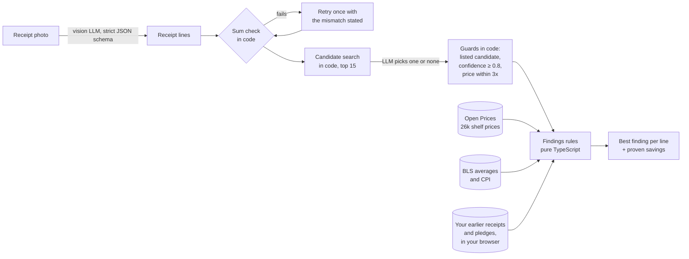

# Chek

**Photograph a grocery receipt. See where you overpaid, with a cited source for every number.**

Live: **https://54-163-135-214.nip.io** · No sign-up · Works on a phone

Chek reads a US grocery receipt and shows, line by line, where the same product was cheaper at
another nearby store, where a comparable product at the same store costs less per ounce, where
a price went up since your last receipt, and where you paid well above the US average. Each
finding shows its evidence: store, price, date and a link to the source record.

Tap **I'll switch next time** on a finding, and the next receipt **proves** what the switch actually
saved, using only what you paid before and what you paid now.

## How to test it (no US receipt needed)

1. On the home page, tap the sample **Week 1**.
2. Tap **I'll switch next time** on two findings. Unlock the rest with the test card `4242 4242 4242 4242`.
3. Tap the sample **Week 2 (follow-up)**. A "Proven on this receipt" block shows then vs now.
4. On **History**, tap **Load 8 weeks of demo history**: proven savings per switch (one switch that
   later cost more), the monthly guarantee counter, and personal inflation next to the BLS figure.

Any receipt photo works too. Stores outside the demo area are read, sum-checked and saved, and the
result says "No price data for this store yet".

## Pipeline



**The model reads and matches; code computes.** The LLM transcribes the receipt and picks a product
from candidates found in code. Every price, saving, total, proven saving and inflation figure comes
from plain functions in `lib/` with unit tests. Headlines are generated from templates.

## Where every number comes from

| Number | Source |
|---|---|
| What you paid | Your receipt, transcribed; the lines must add up to the printed total (±$0.02) |
| Cheaper at another store / cheaper similar product | [Open Prices](https://prices.openfoodfacts.org) (Open Food Facts), a crowd-sourced database of real shelf and receipt prices. Each finding links to the exact observation |
| Price went up | Your own earlier receipt, stored in your browser |
| Above US average | [BLS](https://www.bls.gov) average price, US city average, latest month (labelled "US average", never "your city") |
| Official food inflation | BLS CPI-U food at home, `CUUR0000SAF11` |
| Proven savings | Only your own receipts: price paid then vs price paid now |

A finding without evidence is never rendered. With no data, the app says so.

## What is real and what is sample

| Real | Sample (labelled SAMPLE or DEMO in the UI) |
|---|---|
| All reference prices: 26,062 Open Prices observations of 20,523 products at 21 stores in Mountain View, Sunnyvale and Los Altos, CA (`data/prices.json`) | The 5 sample receipt images in `public/samples/` |
| BLS CPI and 13 average-price series (`data/bls.json`) | The 8-week demo household in `data/demo-history.json` |
| Your own uploaded receipts | |

Sample receipts are built by `scripts/make-samples.ts` from real observations: each line price is that
store's observed price for that product. They go through the same pipeline as an upload (the image is
read by the vision model; product codes are not printed on it). The demo history's prices start from
real observations and move week to week by the real monthly CPI change plus a small documented
per-product offset; one switch is set to cost more later, so a "paid more" case appears. When loaded,
matching, findings, pledge checks, the guarantee counter and inflation are all computed by the live code.

## Evals (measured on the sample receipts, not on real customer receipts)

| Eval | Result | Reproduce |
|---|---|---|
| Parse: sum check passes | 5 / 5 | `npm run eval:parse` |
| Parse: parsed total equals known total | 5 / 5 | `npm run eval:parse` |
| Parse: median time per receipt | 5.6 s | `npm run eval:parse` |
| Match precision (target: wrong matches under 5%) | 98.1% (1 wrong of 52) | `npm run eval:match` |
| Match recall | 89.5% | `npm run eval:match` |
| Unit tests | 29 passing | `npm test` |

The one wrong match: two sizes of the same Pop-Tarts at a store outside the demo area, where no
store price was available to tell them apart. Put real receipt photos in `eval/real/` (git-ignored) and
`npm run eval:parse` reports them separately.

## Paywall and return loop

- Free: the headline amount, the first finding with its proof, the switch list, the proven total.
- **Chek Plus, $4.99/month**: every finding, the proven-savings breakdown per switch, inflation history.
  Findings are locked only when the hidden ones add up to at least the monthly price; otherwise
  the result says "Nothing here worth charging for. This one is free."
- **Guarantee counter**: "Proven savings this month: $X of $20. If we can't prove $20 in a month, that
  month is free." Found (possible) and proven (actual) savings are shown separately. No automated
  refund is built.
- Checkout: Stripe Checkout in test mode when `STRIPE_SECRET_KEY` (`sk_test_…` only) is set. This
  deployment has no Stripe key, so it shows a form titled **"Demo checkout — no real payment"** that
  accepts the test card and sets the same unlock flag.

## Run locally

```bash
npm install
cp .env.example .env.local    # set OPENAI_API_KEY
npm run dev                    # http://localhost:3000
npm test                       # unit tests
npm run seed                   # optional: rebuild data/ from Open Prices and BLS
```

Requires Node 20+. Environment variables are listed in `.env.example`.

## Code map

| Path | What |
|---|---|
| `lib/parse.ts` | Vision call, sum check, one retry |
| `lib/match.ts` | Candidate search, LLM pick, guards, cache |
| `lib/findings.ts` | The four rules, best finding per line, headline |
| `lib/proven.ts` | `verifyPledges`: proven savings from your own receipts |
| `lib/inflation.ts` · `lib/guarantee.ts` · `lib/notices.ts` | Personal inflation, guarantee counter, receipt checks |
| `lib/config.ts` | Every threshold |
| `prompts/` | The two prompts |
| `scripts/seed-*.ts` · `scripts/make-samples.ts` | Reference data and samples |
| `docs/DECISIONS.md` | What the plan assumed, what was found, what was chosen |

## Key dependencies

- LLM: OpenAI (`gpt-5.5`) through the official `openai` SDK with strict JSON-schema output. Any
  OpenAI-compatible endpoint can be set with `OPENAI_BASE_URL`. See `docs/DECISIONS.md` for why not Claude.
- Next.js 15, React 19, Tailwind 4, zod. Stripe (test mode, optional).
- Hosting: one AWS EC2 instance running the Docker image behind Caddy (automatic HTTPS).

## Known limits

- One demo area (Mountain View, Sunnyvale, Los Altos). Elsewhere the receipt is read and saved, and
  only your own history and BLS averages are compared.
- Reference observations are up to 100 days old (the smallest window that keeps 300+ products priced
  at 2+ stores). The observation date is always shown next to a price.
- Matching prefers no match to a wrong match, so some lines stay unmatched (recall about 90% on samples).
- "Cheaper similar product" relies on Open Food Facts categories; it requires a specific category,
  a shared name word and a comparable pack size, and shows both products so you can judge.
- Proven savings need a later receipt.
- Per-instance rate limit (20 scans per 10 minutes per IP); the hard limit is the spend cap on the key.

## Licences and credits

- Price data: [Open Prices](https://prices.openfoodfacts.org) by Open Food Facts contributors, under the
  [Open Database License (ODbL)](https://opendatacommons.org/licenses/odbl/1-0/). See `data/PROVENANCE.md`.
- US average prices and CPI: U.S. Bureau of Labor Statistics (public domain).
