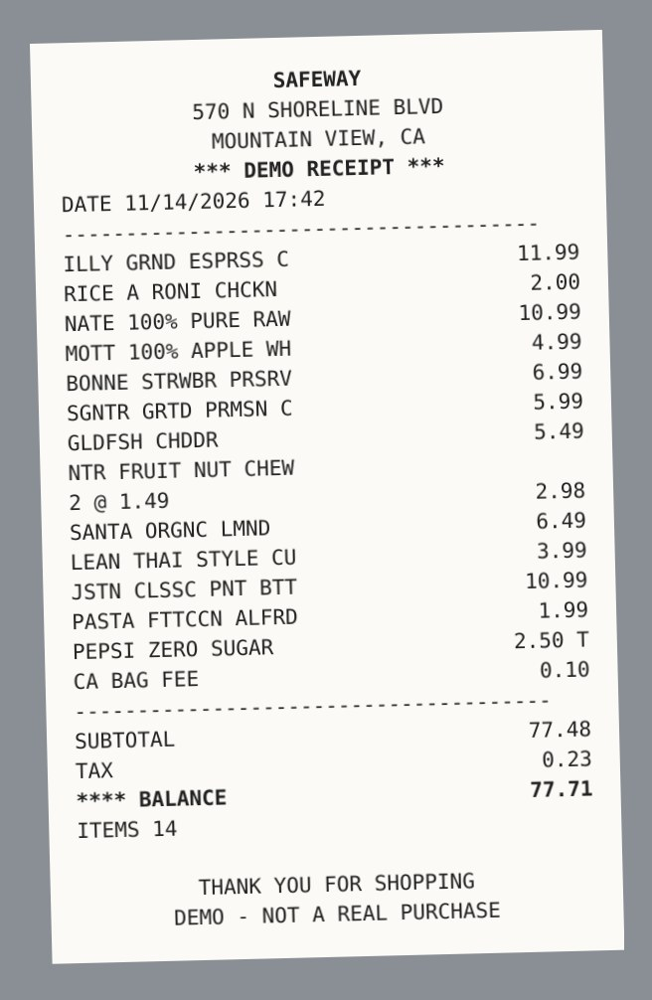

# Jury guide

**Live product: <https://54-163-135-214.nip.io>**. No sign-up and no real payment. It works on a phone.

## 1. The full loop (about 3 minutes)

1. On the home page, tap the sample **Week 1**. In about 10 seconds the receipt is read and every line
   is checked against real shelf prices.
2. Tap **I'll switch next time** on two findings.
3. Unlock the rest with the test card `4242 4242 4242 4242` (any future expiry, any CVC). The checkout
   is a labelled demo, so nothing is charged.
4. Go back and tap the sample **Week 2 (follow-up)**. A **Proven on this receipt** block shows what
   your switches actually saved, from the two receipts only.
5. On **History**, tap **Load 8 weeks of demo history**. You see proven savings per switch (one switch
   that later cost more), the $20 monthly guarantee counter, and your grocery inflation next to the
   official BLS figure.

## 2. Try a receipt you haven't seen

The samples are built into the app. To check that Chek reads any receipt, use this one, which is not in the app:

1. Open [demo-receipt.jpg](demo-receipt.jpg) on your phone and save the image.
   (A [print version](demo-receipt-print.pdf) is also available, 80 mm wide.)
2. On the live site, tap **Scan a receipt** and pick the saved image.

What you should see after about 10 seconds:

- 14 lines read, and the lines add up to the printed total of $77.71.
- **"On this receipt you could have paid $22.42 less."**, with savings on 6 lines.
- A free finding with its proof: Illy espresso at $21.75/lb against the BLS US average of $9.25/lb.
- 5 more findings behind the paywall, for example the same lemonade $2.90 cheaper at Sprouts Sunnyvale.

The amounts can differ by a few cents if a line is read differently.

This receipt is marked **DEMO** and is not a real purchase. We chose the basket and the date. Every
price on it is a real recorded price at Safeway Mountain View from
[Open Prices](https://prices.openfoodfacts.org), the same data that Chek checks against.

 

## 3. Your own receipt

Any receipt photo works. Our price data covers 21 stores in Mountain View, Sunnyvale and Los Altos,
California. A receipt from anywhere else is still read, sum-checked and saved. The result then says
**"No price data for this store yet"**. This is expected. Your next receipt will be compared with it.

## What to look for

| | Where |
|---|---|
| Every finding shows its proof: store, price, the date it was seen, and a link to the source record | Any result |
| The lines must add up to the printed total, or Chek says so instead of guessing | Any result |
| The paywall only shows when the hidden findings are worth more than $4.99. Otherwise: "This one is free." | Any result |
| Proven savings come only from your own two receipts, not from estimates | Week 2, History |
| No account. Receipts stay in your browser, and the server stores no images | Footer, all pages |

## Real and demo

- **Real:** 26,062 shelf prices from Open Prices (ODbL), BLS averages and CPI, the reading and matching
  of every receipt, and all the money math.
- **Demo (labelled in the app):** the 5 sample receipts, the 8-week history, this demo receipt, and the
  checkout.

More detail: [README](../README.md#where-every-number-comes-from) ·
[Decisions log](DECISIONS.md) · [Pitch deck](Chek-pitch-deck.pdf)
